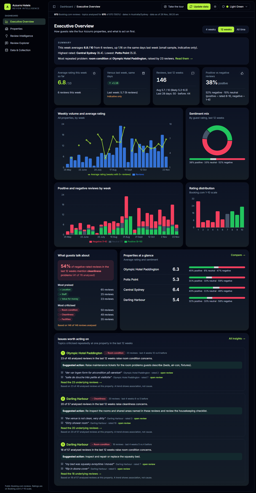
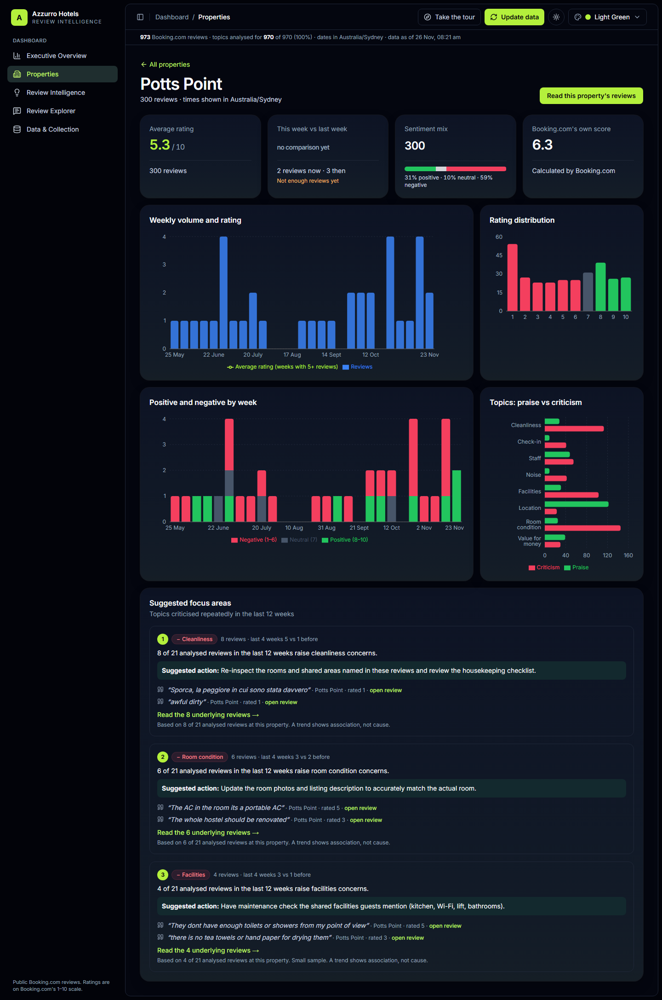
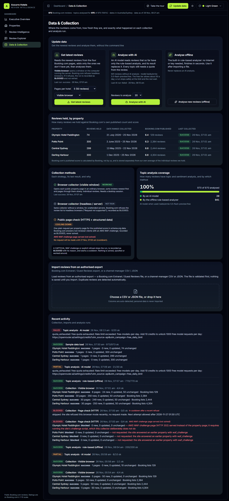
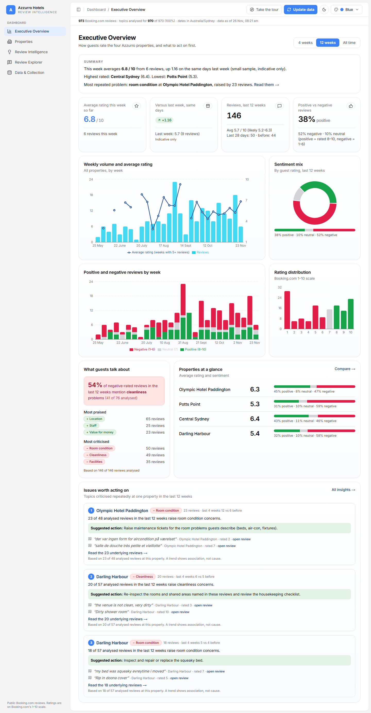
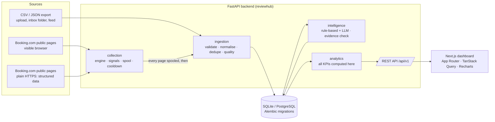

# Azzurro Review Intelligence

Collects and analyses Booking.com guest reviews for four Azzurro Hotels properties, and turns them into a dashboard that non-technical operations staff can use. It shows how guests rate each hotel this week compared with last week, which operational problems keep recurring (with the guests' own words as evidence), and where every number comes from.



| | |
|---|---|
| **Real data** | **973 genuine reviews** collected from the four public Booking.com pages (May 2025 to Nov 2026). Reviewer names are never collected. Committed as [`data/seed/sample_reviews.json`](data/seed/sample_reviews.json). |
| **Insights** | 970 of 970 reviews with text analysed (100%): 29 by an AI model, 941 by the offline rule-based analyzer. Every topic tag is backed by a verbatim quote. |
| **Collection** | Three strategies with honest block reporting. CAPTCHA, AWS WAF challenges and refusals are detected, recorded as **BLOCKED** with the reason, and **never bypassed**. |
| **Checks** | Backend 682 tests (SQLite **and** PostgreSQL), frontend 22 unit tests, 48 end-to-end runs (real and demo data, desktop and mobile). Lint, strict type checks, build and dependency audits are clean. |

---

## Contents
1. [Quick start](#1-quick-start)
2. [Using the dashboard](#2-using-the-dashboard)
3. [Architecture](#3-architecture)
4. [Review collection](#4-review-collection)
5. [Authorised imports](#5-authorised-imports)
6. [Review analysis](#6-review-analysis-ai-and-rule-based)
7. [Metrics and definitions](#7-metrics-and-definitions)
8. [Data model and quality](#8-data-model-and-quality)
9. [Configuration](#9-configuration)
10. [Testing](#10-testing)
11. [Security and privacy](#11-security-and-privacy)
12. [Known limitations and assumptions](#12-known-limitations-and-assumptions)
13. [Repository map](#13-repository-map)

---

## 1. Quick start

Requirements: **Python 3.11+** (developed on 3.13) and **Node 20+** (developed on 22). No API key, Docker or database server is needed: SQLite is the default and the offline analyzer needs no network access.

### Easiest: one command
```bash
setup.cmd                 # Windows: double-click it, or run it in a terminal
./scripts/setup.sh        # macOS / Linux
```
It checks the prerequisites, installs the backend and the dashboard, loads the 973 real reviews, analyses them, builds the dashboard, starts both servers, opens <http://localhost:3000> and prints a short tour. Press **Ctrl+C** to stop. Next time, use `setup.cmd -SkipInstall` (or `--skip-install`) to just start it.
**New to the app? Read the [guided tour](docs/TOUR.md)**: it shows where each part of the brief can be seen.

### Step by step (what the script does)
```bash
# --- backend (terminal 1) ---------------------------------------------------
python -m venv .venv
source .venv/bin/activate              # Windows: .venv\Scripts\activate
cd backend
pip install -e ".[dev]"
reviewhub db upgrade                   # creates data/reviewhub.db (schema + the 4 properties)
reviewhub sample load                  # loads the 973 real reviews (idempotent)
reviewhub ai analyze --provider builtin  # topic + sentiment for every review, offline, ~5 s
reviewhub serve                        # API on http://127.0.0.1:8000  (docs: /docs)

# --- dashboard (terminal 2) -------------------------------------------------
cd frontend
cp .env.example .env.local             # BACKEND_URL=http://127.0.0.1:8000 (server-side only)
npm ci
npm run build && npm start             # http://localhost:3000   (or: npm run dev)
```

This exact sequence was verified on an empty database: 973 reviews loaded and 970 analysed, with no key configured.

**Optional extras**
```bash
cp .env.example .env                   # repo root; edit as needed (never committed)
python -m playwright install chromium  # only to run the live collector yourself
reviewhub seed-demo                    # FICTIONAL demo data: use a separate database, see §8
```
PostgreSQL instead of SQLite: `docker compose up -d db`, then set `REVIEWHUB_DATABASE_URL=postgresql://reviewhub:<password>@localhost:5432/reviewhub` and run `reviewhub db upgrade`.

---

## 2. Using the dashboard

| Page | What operations staff get |
|---|---|
| **Executive Overview** | A plain-English summary, this week's average rating against the same days last week, review volume, positive/neutral/negative mix, weekly rating and sentiment trends, and a ranked list of **issues worth acting on**, each with a suggested action, guest quotes and a link to the reviews behind it. 4-week / 12-week / all-time toggle. |
| **Properties** | All four hotels side by side (average rating, Booking.com's own score kept separate, sentiment, volume trend, most praised/criticised topics), plus a detail page per hotel with its trends, topics and focus areas. |
| **Review Intelligence** | The eight operational topics: praise against criticism, the share of negative reviews mentioning each topic, recurring complaints, supporting quotes, affected properties and recommendations. Every insight links to its underlying reviews. |
| **Review Explorer** | Every review with the guest's wording, highlighted evidence, rating, property, date, traveller type, room type, stay length, sentiment and topics. Search, filters (property, dates, rating, sentiment, topic, praised or criticised), sorting and pagination run on the server. Filters live in the URL, so a filtered view can be shared. |
| **Data & Collection** | **Update data** actions (below), reviews held per property against Booking's published count and score, each collection method's status (**BLOCKED** shown as blocked, with the reason and the next eligible attempt), analysis coverage by method, the import workflow (validate, preview, import), and the full run history. |

**Update data, without the command line** (top bar → *Update data*, or Data & Collection):
| Action | What it does |
|---|---|
| **Get latest reviews** | Runs the collector in the background (choose pages per hotel; visible browser by default), adds only reviews not held yet, then analyses them offline. One run at a time; a refusal is recorded as **BLOCKED** and starts the cooldown. |
| **Analyse with AI** | Sends a chosen number (5–50) of reviews that only have the rule-based analysis to the OpenRouter model, in the background. Disabled, with the reason shown, until a key is configured and `AI_ALLOW_REAL_GUEST_TEXT=true` is set (a data-protection decision). Stops safely at the free daily limit. |
| **Analyse offline** | The rule-based analyzer, in seconds. Use it after importing a file. |

The page follows running jobs and refreshes every screen when they finish.

**First-time users** get an **in-app guided tour**: seven steps that move to each screen and highlight what to look at. It opens by itself on the first visit and can be replayed any time with **Take the tour**. The written version is [docs/TOUR.md](docs/TOUR.md).

**Themes:** light and dark mode, switched with a circular reveal animation, plus six colour presets (Light Green, Blue, Violet, Amber, Teal, Neutral). The choice is remembered per browser and applied before the first paint. The design follows the shadcn/ui dashboard style: a sidebar, an inset content panel with breadcrumbs, and cards with a subtle accent gradient.

Design choices for non-technical users:
- Sample sizes are visible. A week with too few reviews says "not enough reviews yet" instead of showing a misleading swing; zero, missing and insufficient are never confused.
- Colour is never the only signal: sentiment always carries a `+`/`−` mark or a label.
- The layout works on desktop, tablet and mobile, with keyboard navigation (including the theme menu and tour), semantic landmarks and readable contrast in both modes.
- Synthetic data always shows a **DEMO / SYNTHETIC DATA** banner.

| Properties (dark) | Data & Collection: Update data (dark) | Executive Overview (light, Blue preset) |
|---|---|---|
|  |  |  |

---

## 3. Architecture

A **modular monolith** (ADR 0001): one Python package with clear module boundaries, a Next.js frontend, and one database.



| Layer | Technology | Notes |
|---|---|---|
| API | FastAPI, Pydantic 2 | RFC 7807 errors; OpenAPI at `/docs` |
| Persistence | SQLAlchemy 2, Alembic | CHECK/UNIQUE/FK constraints; tested on **both** SQLite and PostgreSQL; a structural test proves migrations equal the models |
| Collection | Playwright (Python), httpx | an unmodified browser; no stealth, no spoofing |
| Analysis | Offline rule-based analyzer; OpenRouter (free models) | one JSON contract, one verification step |
| Frontend | Next.js 16 App Router, React 19, TypeScript (strict), Tailwind CSS 4, TanStack Query 5, Recharts 3, Lucide, Zod 4 | the browser calls the same-origin `/api/v1/*`; Next proxies it to `BACKEND_URL` server-side |
| Tests | pytest, Vitest + React Testing Library, Playwright | see §10 |

**Rules that hold throughout:** business numbers are computed only in `analytics/service.py`, never in React. Every write goes through one ingestion pipeline. Every analytics response carries its data provenance (`meta.dataset`, `meta.analysis.methods`).

---

## 4. Review collection

Booking.com gives no API access, so the brief asks for "a reliable alternative method for collecting publicly available reviews". The constraints were measured on the live site (2026-11-26):

| Client | What Booking.com serves | Our result |
|---|---|---|
| **Visible, unmodified browser** | The property page and the review list | ✅ Reviews collected |
| **Headless browser** | The page, but the review list API answers `Request not supported` | ⛔ Recorded as **BLOCKED** (`headless_refused`) |
| **Plain HTTPS request** | **HTTP 202 + AWS WAF JavaScript challenge** (`challenge.js`, `AwsWafIntegration.getToken()`) | ⛔ Recorded as **BLOCKED** (`aws_waf_challenge`) |
| Rendered review cards | Fields exposed via `data-testid`; **no stable review ID**, no permalink | Identity = content fingerprint |
| Rendered page JSON-LD | `Hotel.aggregateRating`, e.g. 6.4 / 129 reviews | Published score captured separately |

### Strategies

```bash
reviewhub collect --headed --max-pages 30      # 1. visible browser: individual reviews (desktop session)
reviewhub collect                              #    the same collector headless (servers); currently BLOCKED
reviewhub collect --source http                # 2. one HTTPS request per page: published score, WAF detection
reviewhub collect --source inbox               # 3. owner exports dropped in data/inbox/
reviewhub collect --source feed                #    authorised feed (REVIEWHUB_COLLECT_FEED_URL / _TOKEN)
reviewhub runs list                            # history: runs and per-property results
```
Options: `--property <slug>` (repeatable), `--max-pages N` (10 reviews per page), `--full` (ignore what is already held), `--concurrency 1-3`, `--no-resume`.
Exit codes: `0` success, `1` failed, `3` partial, `4` another run in progress, **`6` blocked** (alert a human; do not retry in a loop).

### How the browser collector works
It opens each property page, clicks "Read all reviews", selects **Newest first**, and pages through slowly (2–4 s between pages, 8–15 s between properties, with jitter), the way a visitor would. Per review it extracts: **rating, publication date, title, liked text, disliked text, traveller type, room type, nights**. It does not read the avatar element, so reviewer names are never collected.

### Reliability
| Concern | Handling |
|---|---|
| **No duplicates** | Content fingerprint (property, date, rating, normalised text) under a database UNIQUE constraint. Overlapping pages, retries, interrupted runs, re-imports and manual imports all create nothing new. The deep run on 2026-11-26 re-read 200 held reviews: 0 duplicates. |
| **New reviews only** | Incremental mode stops when a page is entirely older than the newest held review (with a 14-day look-back for late edits). `--full` re-reads from the newest. |
| **Interrupted runs** | Every page is appended and fsynced to a spool file **before** anything else. The next run imports leftovers first and resumes at the last page read. A crashed run is reaped by heartbeat. |
| **Temporary failures** | Network errors, timeouts, 5xx and 429 are retried with bounded exponential backoff and jitter. `Retry-After` is honoured, with a cap. |
| **Page changes** | No cards, pagination that does not advance, or an unexpected redirect → `structure_changed`: stop, report, never guess. |
| **CAPTCHA / WAF / denied** | Classified as **site decisions**: never retried, never solved. The circuit breaker stops every worker (other properties are **not requested**), the run is recorded as **BLOCKED** with the reason, and a **24 h cooldown** per mode means a scheduled job makes no request in that window. Challenge pages are never parsed as reviews. Already-collected data is preserved. |
| **History** | `run` + `run_property` rows (status, pages, new/updated/unchanged/rejected, Booking's reported total, error) and a JSONL event log per run (no cookies, headers, HTML or names). |

### What we deliberately do not do
No CAPTCHA solving, no running or replaying the WAF challenge outside a real browser, no token reuse, no stealth plugins or fingerprint spoofing, no proxy rotation, no replay of Booking's internal APIs, no login. An early experiment that used anti-detection techniques was withdrawn and its data quarantined (ADR 0002). Since review-level data can be collected without any of these, building them would only add legal and ethical risk. The design and evidence are in [ADR 0022](docs/adr/0022-collection-architecture.md) and [ADR 0024](docs/adr/0024-http-structured-strategy.md).

### Collected sample (2026-11-26, visible browser, newest first)
| Property | Reviews held | Booking.com published | Collected range |
|---|---|---|---|
| Olympic Hotel Paddington | 74 | 129 reviews · **6.4** | Jul – Nov 2026 |
| Potts Point | 300 | 2,384 reviews · **6.3** | Jun 2025 – Nov 2026 |
| Central Sydney | 299 | 2,444 reviews · **6.6** | May 2025 – Nov 2026 |
| Darling Harbour | 300 | 4,304 reviews · **6.6** | Dec 2025 – Nov 2026 |

`reviewhub sample export` regenerates the sample file from the database. `reviewhub sample load` loads it as `booking_public` (its true origin) through the normal pipeline.

---

## 5. Authorised imports

The permitted route to complete, unattended review data is the owner's own export: Booking.com Extranet / Guest Reviews, or a channel manager.

- **Dashboard:** Data & Collection → *Import reviews*: choose a CSV/JSON file → **Validate** (dry run: rows, valid, would add, already held, rejected, row-level errors) → **Import**. You can map the file to a property when it has no property column.
- **CLI:** `reviewhub import reviews.csv --dry-run`, then `reviewhub import reviews.csv`.
- **API:** `POST /api/v1/ingestion/imports` (multipart; `dry_run`, `property`, `date_format`).
- **Unattended:** `data/inbox/` (`collect --source inbox`) or an authorised HTTPS feed (`collect --source feed`).

Columns are auto-detected. Personal-data columns (guest name, e-mail…) are **ignored and reported**, never stored. Valid rows are committed even when other rows fail (partial import, reported per row); a file-level error writes nothing. Re-importing the same file changes nothing, and an edited review becomes one update with a stored revision. Full format, validation codes and exit codes: [docs/IMPORT_FORMAT.md](docs/IMPORT_FORMAT.md).

---

## 6. Review analysis (AI and rule-based)

Each review gets an overall sentiment (`positive` / `negative` / `neutral` / `mixed`) and per-topic aspects for the eight operational topics: **cleanliness, check-in, staff, noise, facilities, location, room condition, value for money**. Each aspect has a polarity and **verbatim evidence**. Where there is a complaint, the review also gets a main complaint and a suggested action.

| | Rule-based analyzer (`builtin`) | AI model (`openrouter`) |
|---|---|---|
| Run | `reviewhub ai analyze --provider builtin`, or the dashboard's *Analyse offline* | `reviewhub ai analyze --provider openrouter`, or the dashboard's *Analyse with AI* |
| Needs | nothing: offline, deterministic, ~1,000 reviews/s | `OPENROUTER_API_KEY`, a `:free` model; ~50 requests/day on the free tier |
| How | Booking's liked/disliked boxes give polarity; clauses are matched to topics with multilingual cue lists (en, fr, de, es, it, pt, nl, da, sv); negation flips polarity ("not clean"); absence counts as a complaint ("no lift") | strict JSON schema, one re-ask on invalid output |
| Coverage now | 941 reviews | 29 reviews (+5 failed and recorded) |

**Shared safeguards** (both methods use the same pipeline):
- **Evidence verification.** Every quote must be found verbatim in the review (allowing for case, quote style and whitespace). Unverifiable quotes are dropped; an analysis with no verifiable evidence is `failed` and never shown. Model text is never presented as guest wording.
- **Prompt injection.** Review text is untrusted data passed as JSON inside `<review>` tags; the system prompt tells the model to treat it as data and flag attempts (`possible_prompt_injection`). Tested.
- **Status tracking.** `pending → ok | needs_review | failed`, with provider, model, prompt/taxonomy version, input hash, tokens, cost and attempts. Failed reviews are retried up to 3 times; 5 consecutive failures, an exhausted quota, an invalid key or a paid response stop the run safely, and it resumes later.
- **No needless re-analysis.** The cache key is the review text hash plus the provider, model, prompt and taxonomy versions.
- **Precedence.** One current analysis per review: **AI > rule-based > test mock**. The dashboard labels which method produced each one and never calls rule-based output "AI".
- **Data protection.** Real guest text goes to the external provider only when `AI_ALLOW_REAL_GUEST_TEXT=true`, an operator decision (D7). The operator authorised one capped run on 2026-11-26.

**How good is it?** There is no human-labelled evaluation set yet, so **no accuracy is claimed** (ADR 0014). What we can measure is consistency. On the 29 real reviews analysed both ways (`reviewhub ai agreement`):

| | Rule-based vs AI |
|---|---|
| Topic detection | precision 0.92 · recall 0.86 · **F1 0.89** |
| Polarity on shared topics | **0.96** agreement |
| Overall sentiment | 0.72 agreement |

The rule-based analyzer is weakest on sarcasm, comparisons, long multi-topic sentences, misspellings, and languages outside its word lists. Language is detected offline; short text is `und` (undetermined), not guessed. Details: [ADR 0005](docs/adr/0005-hybrid-absa.md), [ADR 0021](docs/adr/0021-openrouter-only.md), [ADR 0023](docs/adr/0023-rule-based-analyzer.md).

---

## 7. Metrics and definitions

All metrics are computed by the backend from stored reviews and analyses. Model-written text (summaries, actions) is displayed but never used to compute a number.

| Metric | Definition | Denominator |
|---|---|---|
| **Average rating** | mean of individual guest ratings (1–10), review-weighted (never a mean of property means) | reviews in the window |
| **Current week** | Monday 00:00 → now, Australia/Sydney local time | — |
| **Previous week (like-for-like)** | the same elapsed wall-clock span one week earlier (Mon 00:00 → same weekday and time), so it is DST-safe; the full previous week is shown alongside | — |
| **Week-on-week change** | current − like-for-like, marked *indicative* unless both samples are adequate | — |
| **Positive / neutral / negative** | rating ≥ 8 / = 7 / ≤ 6 (decision D5) | reviews in the window |
| **Sentiment (text)** | overall sentiment from the current analysis | analysed reviews |
| **Topic frequency** | unique reviews with an aspect on the topic, split by polarity | analysed reviews |
| **"X% of negative reviews mention cleanliness"** | negative-rated reviews with a negative or mixed cleanliness aspect | **all** negative-rated reviews in the window (including unanalysed or topic-less ones) |
| **Recommendations** | a topic criticised by ≥ 3 reviews at one property in 12 weeks, ranked by count, then by 4-week trend | analysed reviews at that property |
| **Analysis coverage** | reviews with a current analysis | reviews with text |
| **Booking.com score** | Booking's own published figure (from the page's JSON-LD), stored per capture | **not** an average of our reviews; shown separately |

**Sample-size policy.** An average needs n ≥ 5 (*low sample* below 15); a proportion needs a denominator ≥ 10 (*low sample* below 30). Below that the value is withheld and the count is shown. **Zero, missing, insufficient sample and unanalysed are distinct states.** A 95% interval accompanies averages.

**Time.** Each review's local date and week are derived from its property's timezone at ingestion (all four are Australia/Sydney). DST transitions and the Sunday/Monday boundary are covered by tests.

---

## 8. Data model and quality

Main tables: `property`, `review`, `review_revision`, `review_analysis`, `review_aspect`, `run`, `run_property`, `score_snapshot`, `data_quality_issue`. Two Alembic migrations; the second contains only the four properties (reference data). No review data is ever put in migrations.

- **Constraints:** rating within 1–10; source within an allowed list; a UNIQUE `dedupe_key`; one current analysis per review (partial unique index); a failed analysis can never be current; cascading FKs.
- **Provenance:** `source` (`booking_public`, `csv_import`, `json_import`, `demo_synthetic`), `first_run_id` / `last_run_id`, `collected_at`, `first_seen_at`, `last_seen_at`, and a PII-free `source_payload`.
- **Quality checks (DQ001–DQ019):** missing text, filler answers ("Nothing"), out-of-range values, future dates, near-duplicates, encoding damage… reported per row and stored as issues.
- **Dataset isolation:** a database holds real **or** synthetic data, never both. Loading one kind into the other is refused (HTTP 409 / CLI exit 5). Reporting excludes synthetic data unless `include_demo` is set, and the UI then shows a **DEMO / SYNTHETIC DATA** banner. To demo with fictional data: `REVIEWHUB_DATABASE_URL=sqlite:///data/demo.db reviewhub db upgrade && ... seed-demo`.

---

## 9. Configuration

Backend settings come from environment variables or a repo-root `.env` ([.env.example](.env.example) has placeholders only). The frontend uses `frontend/.env.local` ([frontend/.env.example](frontend/.env.example)).

| Variable | Default | Purpose |
|---|---|---|
| `REVIEWHUB_DATABASE_URL` | `sqlite:///data/reviewhub.db` | or `postgresql://…` |
| `AI_PROVIDER` | `none` (`.env.example`: `builtin`) | `builtin` · `openrouter` · `mock` · `none` |
| `OPENROUTER_API_KEY`, `OPENROUTER_MODEL` | — | backend only; the model must end in `:free` |
| `AI_ALLOW_REAL_GUEST_TEXT` | `false` | allow real review text to go to the external provider |
| `REVIEWHUB_COLLECT_BROWSER_MODE` | `headless` | `headless` · `headed` |
| `REVIEWHUB_COLLECT_BLOCK_COOLDOWN_HOURS` | `24` | no request after a refusal, per mode |
| `REVIEWHUB_COLLECT_*` | see [settings.py](backend/src/reviewhub/core/settings.py) | timeouts, retries, backoff, pacing, folders |
| `BACKEND_URL` (frontend) | `http://127.0.0.1:8000` | read server-side by the Next.js proxy; never exposed to the browser |

---

## 10. Testing

```bash
cd backend
ruff check . && mypy && pytest           # every DB test runs on SQLite AND PostgreSQL
cd ../frontend
npm run lint && npm run typecheck && npm test && npm run build
# end-to-end against a running stack (backend + `npm start`), first time: npx playwright install chromium
E2E_MODE=real E2E_BASE_URL=http://127.0.0.1:3000 npx playwright test
E2E_MODE=demo E2E_BASE_URL=http://127.0.0.1:3001 npx playwright test   # stack on the demo database
```
Without Docker, the backend tests start an embedded PostgreSQL (`pixeltable-pgserver`). CI uses a PostgreSQL service and **fails** rather than skipping if it is missing.

**Results (2026-11-26, run locally):**
| Suite | Result |
|---|---|
| Backend: ruff, ruff format, mypy `--strict` | clean |
| Backend: pytest (SQLite + PostgreSQL) | **682 passed**, 0 skipped |
| Frontend: ESLint, `tsc` (strict), `next build` | clean |
| Frontend: Vitest + React Testing Library | **22 passed** |
| End-to-end: Playwright, real data | **24 passed** (12 scenarios × desktop + mobile) |
| End-to-end: Playwright, synthetic demo data | **24 passed** |
| `npm audit --omit=dev`, `pip-audit` | 0 known vulnerabilities |

What the tests cover:
- **Collection:** card parsing, the AWS WAF challenge (**a live response, saved as a fixture with session values redacted**), CAPTCHA (including one served with HTTP 200), access denied, 429 with `Retry-After`, 5xx retry, unexpected redirects, the circuit breaker (one request, then stop), the cooldown (zero requests), spool and resume after a killed process, pagination that does not advance, and incremental stop rules.
- **Imports and data:** validation, partial failures, deduplication under concurrency, schema/migration equivalence, constraints, timezones and DST.
- **Analysis:** the analyzer, evidence verification, prompt injection, provider failures and quota, precedence, agreement.
- **Analytics:** every metric, sample-size states, evidence polarity.
- **Frontend:** navigation, KPIs, property comparison, filters, sorting, pagination, search, insight → reviews, collection history and BLOCKED rendering, the import preview → commit flow, Zod contract errors, error and empty states, and synthetic-data labelling.

**Live versus mocked, stated plainly:** live collection was run against Booking.com on 2026-11-26 (visible browser: 973 reviews; HTTP strategy: WAF challenge observed). The **automated tests never contact Booking.com or OpenRouter**: they use fixtures, fakes and a deterministic mock provider. The 29 real AI analyses came from live OpenRouter runs, not tests.

---

## 11. Security and privacy

- **No secrets in the repository.** `.env`, databases, the browser profile, spool, logs and cookies are git-ignored. The real OpenRouter key was checked: it is present in **0** shippable files; the only key-like strings are fake keys in redaction tests. Keys are read only from the backend environment, held as `SecretStr`, and redacted from stored errors. They are never logged or returned by the API.
- **Frontend:** no `NEXT_PUBLIC_*` variables. The browser only talks to the same-origin proxy, and the backend address is server-side.
- **Imports:** size limit (20 MB), encoding and format detection, strict per-row validation, no file paths taken from user input, and a source the file cannot choose. Personal-data columns are dropped and reported.
- **Guest privacy:** reviewer names are never read by the collector and never imported. Free text can still contain names guests typed themselves (e.g. staff names); this is stated, not hidden.
- **Access controls:** never circumvented (see §4).
- **Logging:** structured JSON with no cookies, headers, page HTML, keys or reviewer names.

---

## 12. Known limitations and assumptions

- **Review-level collection needs a visible browser.** Booking.com refuses headless clients and challenges plain HTTP, so a server cannot collect unattended. The permitted unattended route is an owner export (Extranet / channel manager) via the inbox or feed, which is built and ready. **What Azzurro would need to provide:** Extranet export access, or channel-manager feed credentials.
- **Partial history:** we hold the newest ~300 reviews for the three large properties (about 7–13% of their published totals) and 74 of Olympic's 129. Paging further is possible but slow by design.
- **Terms of service:** Booking.com's terms restrict automated access. Whether to run the public-page collector is Azzurro's business decision; the system makes it easy to switch to owner exports.
- **Edited reviews:** with no public review ID, an edited review looks like a new one (the fingerprint changes).
- **Publication date, not stay date,** defines weeks (stay dates keep changing for weeks after a stay).
- **Small weekly samples:** most single-property weeks have fewer than 5 reviews. The dashboard says so rather than showing noise.
- **Analysis quality:** rule-based for most reviews; LLM coverage grows by about 50 reviews a day on the free tier; no human-labelled accuracy figure yet.
- **Assumptions:** the publication date shown is Booking's "Reviewed" date; all four properties are in Australia/Sydney; Booking's 1–10 scale.

---

## 13. Repository map

```
backend/src/reviewhub/
  collection/   engine (retries, pacing, checkpoints) · browser (Playwright I/O) · public (card parsing)
                http_page (HTTPS strategy) · structured (JSON-LD) · signals (CAPTCHA/WAF/denied)
                spool (durability) · feeds (inbox, feed) · status (reliability report) · service (orchestration)
  ingestion/    adapters (CSV/JSON) · normalise · dedupe · quality · service (the one write path)
  intelligence/ lexicon (rule-based) · language · prompt · providers (OpenRouter, mock) · schema (evidence check)
                service (resumable runs, precedence) · agreement
  analytics/    service.py: every metric
  api/v1/       health · ingestion · analytics · analysis
  persistence/  models · migrations · runs (heartbeat, reaping) · scopes (dataset isolation)
backend/tests/  682 tests; fixtures/ holds the redacted live WAF page and a JSON-LD page
frontend/src/   app/ (5 pages + property detail) · components/ · hooks/ (TanStack Query) · services/ (API client, Zod) · test/
frontend/e2e/   Playwright end-to-end suite
data/seed/      sample_reviews.json: the 973 real reviews
docs/           adr/ (24 decision records) · IMPORT_FORMAT.md · ENGINEERING_AUDIT.md · screenshots/
```

More detail: [docs/adr/README.md](docs/adr/README.md) (decisions and open questions) and [docs/ENGINEERING_AUDIT.md](docs/ENGINEERING_AUDIT.md) (the original proposal; its measurements in §2 and §4.5 come from the withdrawn experimental dataset and are kept for context only).
