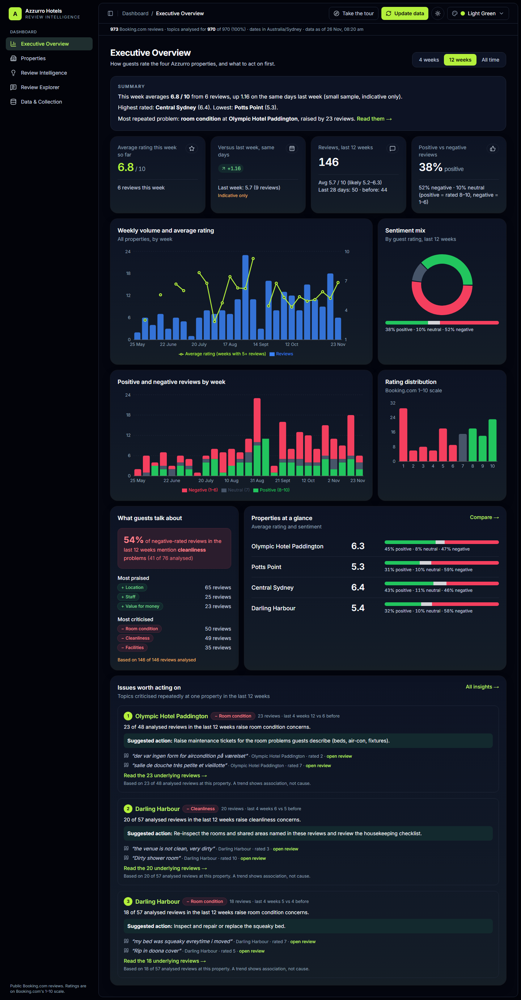
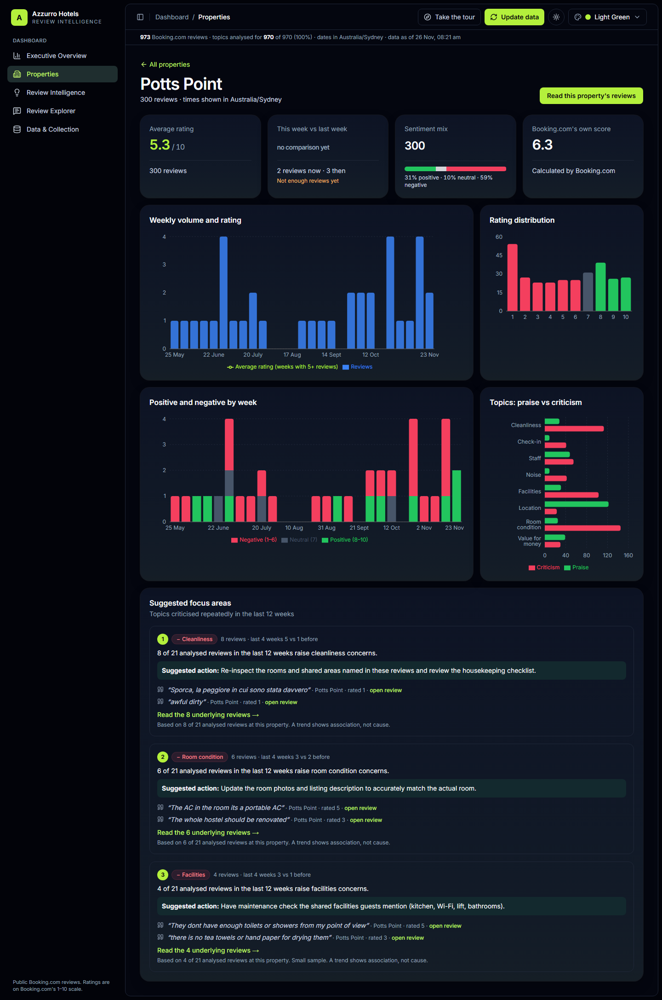
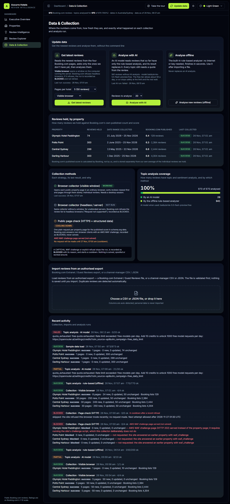

# Guided tour

A 5-minute walk through the dashboard: what each screen is for, and where each requirement of the brief can be seen.

**Start it:** double-click `setup.cmd` on Windows, or run `./scripts/setup.sh` on macOS/Linux. Then open <http://localhost:3000>. The left sidebar holds the five screens.

**There is an in-app version of this tour.** It opens by itself on your first visit, moves to each screen and highlights what to look at. Replay it any time with **Take the tour** in the top bar.

---

## Where to find each requirement

| The brief asks for… | Where to see it |
|---|---|
| Average rating for the current week | **Executive Overview** → first dark tile, "Average rating this week so far" |
| Comparison against the previous week | **Executive Overview** → second tile, "Versus last week, same days" (the same elapsed days, not a full week) |
| Property-by-property rating breakdown | **Properties** → one card per hotel, plus the "Side by side" table |
| A review feed to browse and read reviews | **Review Explorer** |
| Date and property filters | **Review Explorer** → filter panel (also rating, sentiment, topic, search, sort) |
| Positive and negative review trends | **Executive Overview** → "Positive and negative reviews by week" |
| Reviews grouped into operational topics | **Review Intelligence** → "Topic by topic" (all eight topics) |
| "40% of negative reviews mentioned cleanliness" | **Executive Overview** → "What guests talk about" (red box), and on every topic card in **Review Intelligence** |
| Collection method, errors and limitations | **Data & Collection** → "Collection methods" and "Recent activity" |
| No duplicates, new reviews picked up | **Data & Collection** → "Recent activity" (new / unchanged counts per run) |

---

## 1. Executive Overview (`/`)

The morning check for a manager.
1. **Summary** (top): three plain-English sentences covering this week's rating, the best and worst property, and the most repeated problem.
2. **Four tiles:** the rating this week, the change against the same days last week, review volume, and the positive/negative mix. *"Indicative only"* or *"Not enough reviews yet"* appears when the sample is too small to trust.
3. **Charts:** weekly volume and rating, positive against negative reviews by week, and the rating distribution.
4. **What guests talk about:** the headline insight, e.g. *"54% of negative-rated reviews mention cleanliness"*, plus the most praised and most criticised topics.
5. **Issues worth acting on:** a ranked list. Each item shows the property, the topic, how many reviews raised it, a suggested action and real guest quotes. **"Read the N underlying reviews →"** opens exactly those reviews.

Use the **4 weeks / 12 weeks / All time** switch at the top right to change the period.

## 2. Properties (`/properties`)
All four hotels side by side: our average rating, **Booking.com's own published score** (shown separately, because Booking calculates it differently), sentiment, volume and top topics.
**Click a hotel name** to open its page, with its own trends, rating distribution, topic chart and *"Suggested focus areas"*. **"Read this property's reviews"** jumps to its reviews.

## 3. Review Intelligence (`/insights`)
The eight operational topics: cleanliness, check-in, staff, noise, facilities, location, room condition, and value for money.
- **Praise and criticism by topic:** the overall picture.
- **Prioritised recommendations:** what to fix first.
- **Topic cards:** for each topic, how many reviews mention it, **what % of negative reviews mention it**, the most common complaints and the guests' own words. **"Read the N reviews →"** opens them.
- Filter by **property** at the top right.

## 4. Review Explorer (`/reviews`)
Every review as the guest wrote it, in their own language, with the words that triggered each topic **highlighted** (green for praise, red for criticism).
- **Search** any word (e.g. *"air conditioning"*), filter by **property, dates, rating, sentiment, topic**, choose whether a topic was praised or criticised, then sort and page through.
- Each review shows the rating, property, date, traveller type, room type and stay length.
- The small note under each review says which method analysed it: **an AI model** or **the offline rule-based analyzer**.
- Filters are kept in the address bar, so a filtered view can be bookmarked or shared.

## 5. Data & Collection (`/data`)
Where the numbers come from, and where you **update the data**. Open this page when something looks wrong.
- **Update data** (also in the top bar):
  - **Get latest reviews** reads the newest reviews from Booking.com and adds only new ones, then analyses them.
  - **Analyse with AI** lets an AI model read reviews that so far have only the rule-based analysis.
  - **Analyse offline** runs the built-in analyzer in seconds.

  Running jobs show a progress line, and every screen refreshes when they finish.
- **Reviews held, by property:** how many we hold against Booking.com's published count, the date range, and when each property was last collected.
- **Collection methods:** each way of collecting and its status. **BLOCKED** means Booking.com refused (for example with an AWS WAF challenge); the reason and the next allowed attempt are shown. Blocks are recorded, never worked around.
- **Topic analysis coverage:** the share of reviews analysed, and by which method.
- **Import reviews:** upload a CSV or JSON export (Booking.com Extranet, channel manager), press **Validate** to preview what would happen (new, already held, rejected rows and the reasons), then **Import**. Nothing is saved until you import.
- **Recent activity:** every collection, import and analysis run, with its result.

---

## Make it yours
- **Light or dark:** the sun/moon button in the top bar switches with a circular animation.
- **Colours:** the colour menu next to it offers Light Green, Blue, Violet, Amber, Teal and Neutral.

Your choice is remembered in this browser.

## Good to know
- **Ratings** use Booking.com's 1–10 scale. *Positive* = 8–10, *neutral* = 7, *negative* = 1–6.
- **Small numbers are flagged, not hidden.** A property often gets only 1–4 reviews a week, so weekly figures say when they are too small to trust.
- **Every topic tag is backed by a quote** from the review itself, so nothing is invented.
- **The grey bar at the top of every page** shows how many reviews are loaded, how many have been analysed, and how fresh the data is.
- **Demo data:** if fictional data is ever loaded, every screen shows a yellow **DEMO / SYNTHETIC DATA** banner.
